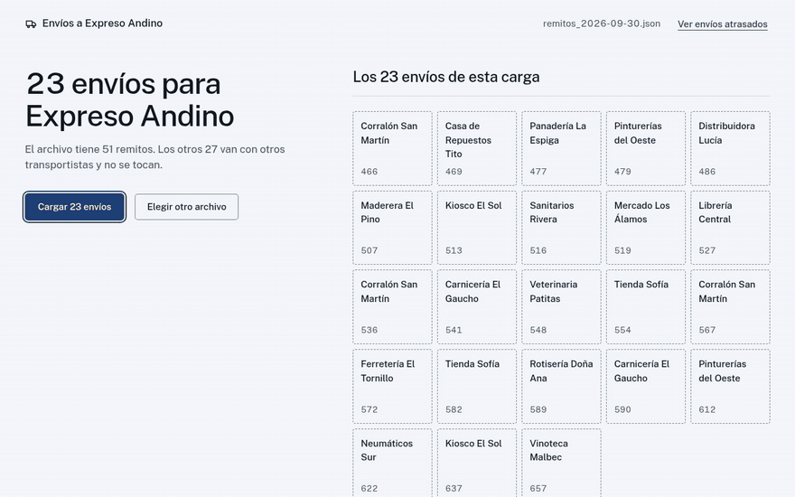
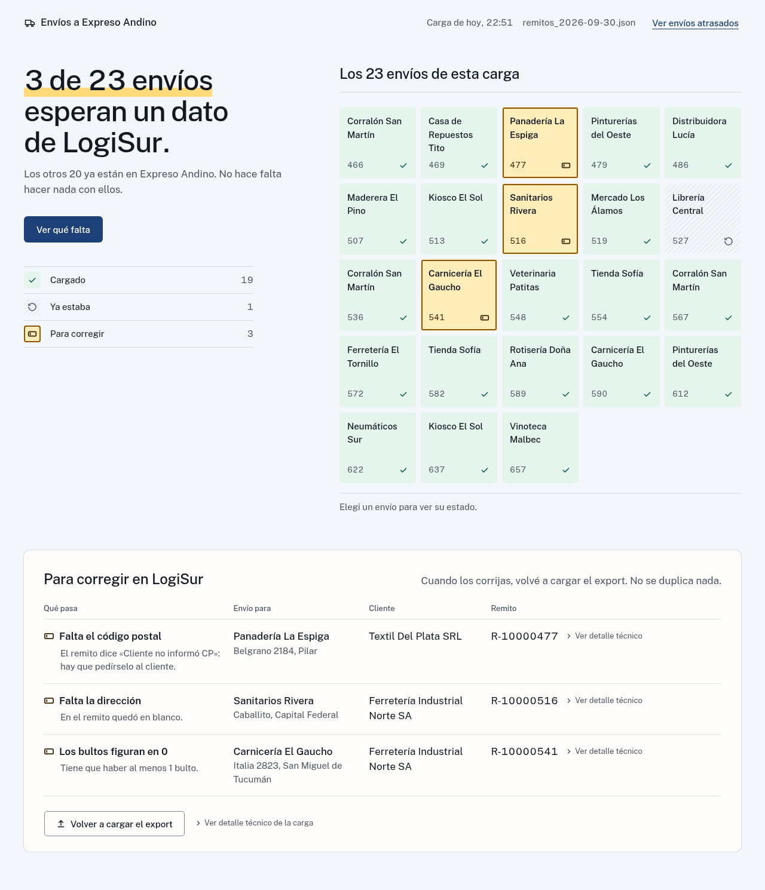
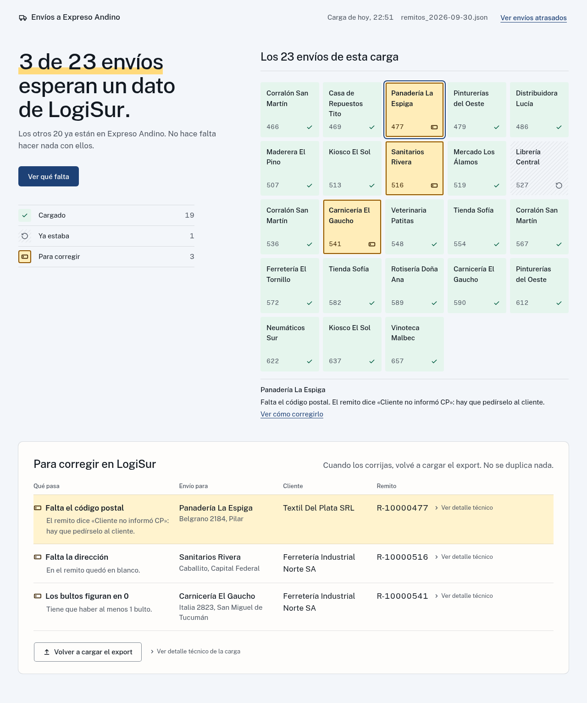
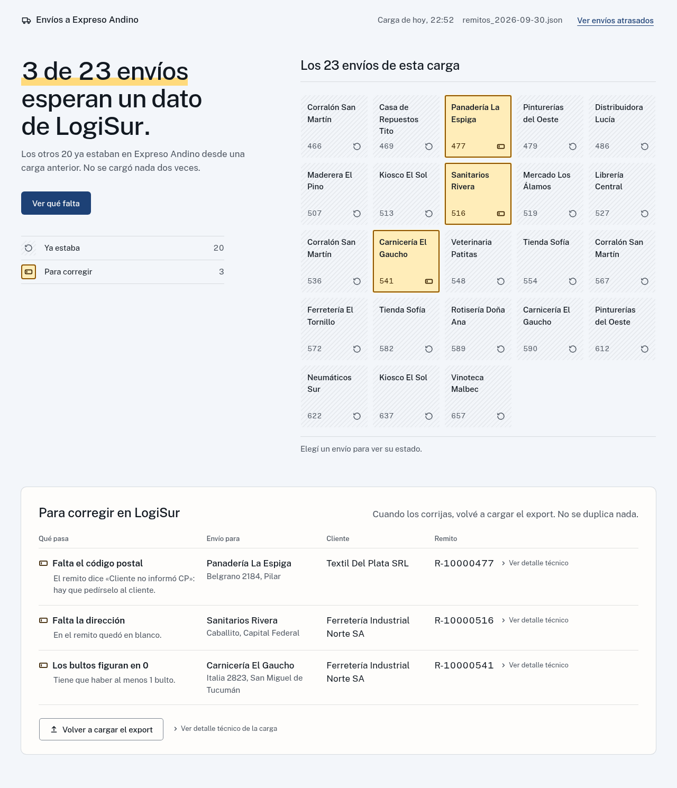
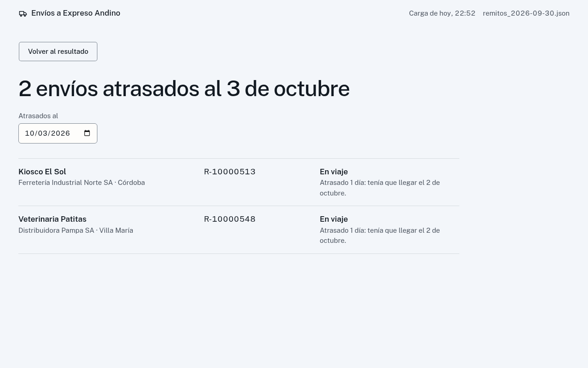
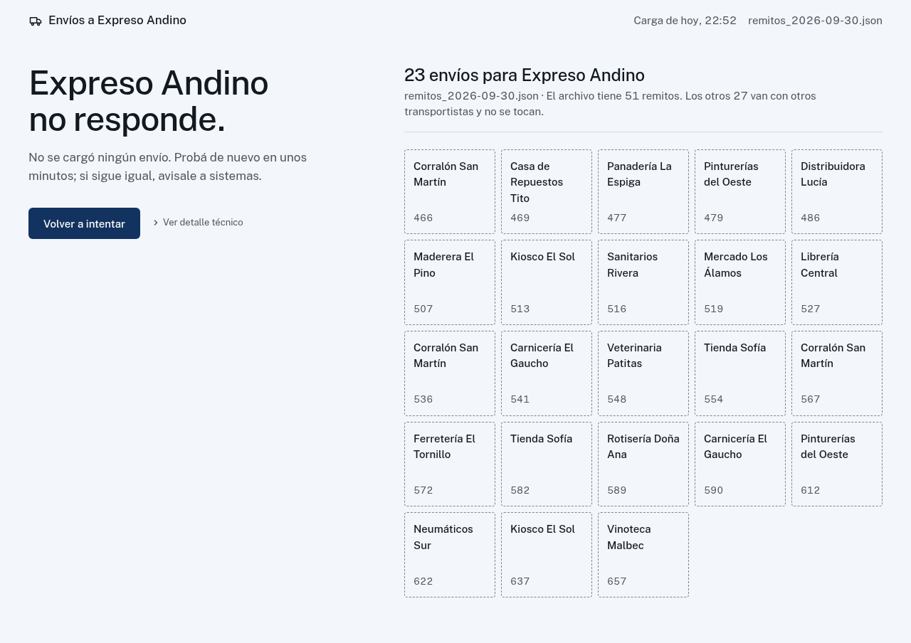
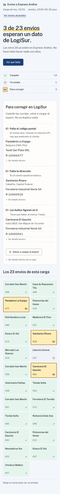

# Expreso Panel

Panel web para que el equipo de operaciones de LogiSur vea, sin conocimientos técnicos, qué pasó al cargar el export diario de remitos en Expreso Andino: una frase que dice si hay algo para hacer, un casillero por envío, y el detalle técnico plegado. Funciona como una capa sobre el puente [caso-expreso](https://github.com/Mateocas1/caso-expreso); no reemplaza su línea de comandos.

Nació de una pregunta en la entrevista técnica con Geno Insights: cómo se le vendería esta automatización a un cliente, si quien la usa no es técnico y en la terminal ve códigos como 409 o 503.

Solo usa la librería estándar (Python 3.9+): no hay nada que instalar.

## Cómo se ve

Una carga en vivo: cada casillero es un envío y se completa cuando Expreso Andino lo confirma. Al terminar, la frase de arriba dice si hay algo para hacer.



| Resultado de la primera carga | Lo que hay que corregir, envío por envío |
| --- | --- |
|  |  |
| **Segunda carga del mismo export: no se duplica nada** | **Envíos atrasados a una fecha** |
|  |  |
| **Expreso Andino no responde** | **En el celular, lo que hay que corregir va primero** |
|  |  |

Las tres direcciones de diseño que se exploraron antes de construirlo están en la [bitácora](docs/bitacora.md#tres-direcciones).

## Abrirlo con doble clic

1. Cloná el repositorio con su submódulo: `git clone --recurse-submodules https://github.com/Mateocas1/expreso-panel`. La descarga en ZIP de GitHub no trae el puente.
2. En Windows, doble clic en **`Abrir panel.bat`**. En Linux, **`Abrir panel.sh`**: con clic derecho → «Ejecutar como un programa» en GNOME, o doble clic en KDE y Xfce. Se abre una ventana con el estado y el panel en el navegador.
3. Para apagarlo, cerrá esa ventana.

Sin configuración, el panel abre en **modo prueba**: levanta la API de prueba del kit en la misma computadora y lo avisa en la cabecera. Para usar la API real de Expreso Andino, copiá `expreso.ini.ejemplo` como `expreso.ini` y completá `url` y `api_key`; ese archivo no se versiona.

Hace falta Python 3.9 o superior. En Windows, al instalarlo, marcá «Add python.exe to PATH». Desde una terminal, lo mismo es `python3 -m panel.launcher`.

Si el puerto 8080 está ocupado (por ejemplo, porque el panel ya estaba abierto), usa uno libre y abre el navegador ahí; la dirección que quedó se ve en la ventana. Si el navegador no se abre solo, copiá esa dirección en la barra.

## Cómo correrlo a mano

```bash
git submodule update --init

# 1. Levantar la API de prueba (en otra terminal)
python3 vendor/caso-expreso/kit/expreso_api.py

# 2. Levantar el panel
EXPRESO_API_KEY=andino-test-7f3a91 python3 -m panel
# opcional: EXPRESO_API_URL (por defecto http://localhost:8000) y --port (por defecto 8080)
```

`andino-test-7f3a91` es la clave de prueba publicada en el kit del puente, no un secreto. La API del kit usa el puerto 8000; si está ocupado, pasale otro (`python3 vendor/caso-expreso/kit/expreso_api.py 8001`) y apuntá el panel ahí con `EXPRESO_API_URL=http://localhost:8001`. A mano, la cabecera no muestra «Modo prueba»: ese aviso solo aparece con el doble clic.

Si el puerto está ocupado, el panel lo dice y no arranca: «El puerto 8080 ya está en uso. Probá con otro: python3 -m panel --port 8090».

La API del kit guarda sus datos en memoria: si la reiniciás, la próxima carga vuelve a ser una primera corrida (todo se carga de nuevo, nada figura como «Ya estaba»).

Abrir http://127.0.0.1:8080, elegir el export (`vendor/caso-expreso/kit/remitos_2026-09-30.json`) y cargar. Los exports subidos y los resúmenes quedan en `runs/`, que no se versiona. La clave nunca llega al navegador.

Para comprobar que el panel responde: `curl http://127.0.0.1:8080/api/config` devuelve `{"testMode": false}` (`true` si lo abriste con el doble clic sin `expreso.ini`). El panel solo atiende pedidos dirigidos a `127.0.0.1`, `localhost` o `[::1]` con su puerto; con otro `Host` responde `403`.

## Cómo usa el puente sin cambiarlo

- El puente es un submódulo de git en `vendor/caso-expreso`, fijado en `5147381`. No se edita nada ahí.
- El panel importa sus funciones públicas en el mismo proceso (`load_remitos`, `is_andino`, `ExpresoClient`, `upload_remitos`, `render_run_report`, `find_overdue`). No corre la línea de comandos, no llama funciones privadas y no repite ninguna regla del puente (deduplicado, clasificación, reintentos, validación).
- El avance en vivo sale de la línea de log que `upload_remitos` ya escribe por cada remito: el panel la escucha mientras dura la carga y la reenvía al navegador.
- Lo que el puente no cubre (un JSON que no es una lista de remitos, un remito sin `nro_remito`, un `401` a mitad de la carga) el panel lo atrapa al envolver la llamada. Detalle en [`docs/como-se-construyo.md`](docs/como-se-construyo.md).

## Tests

```bash
git submodule update --init
python3 -m unittest
```

Son 187 tests. Levantan solos la API de prueba del kit y recorren la primera y la segunda corrida contra ella, así que no hace falta tener nada corriendo.

## Estructura

```
Abrir panel.bat      doble clic en Windows
Abrir panel.sh       lanzador para Linux
expreso.ini.ejemplo  configuración de la API real (copiar como expreso.ini)
panel/
  launcher.py   lo que corre el doble clic: modo prueba o API real, navegador, puerto libre
  bridge.py     adaptador sobre el puente: vista previa, carga con avance, atrasados
  phrases.py    las frases de operaciones (resultados del puente → texto)
  server.py     servidor HTTP con eventos en vivo (SSE)
  static/       la página
tests/          unitarios y de punta a punta contra la API del kit
design/         direcciones visuales y decisiones de diseño
docs/           bitácora, cómo se construyó (etapas, revisiones, API HTTP) e imágenes (docs/img/)
vendor/         el puente (submódulo, solo lectura)
```

## Dónde seguir leyendo

- [`docs/bitacora.md`](docs/bitacora.md): el porqué. El problema, para quién se diseñó, los principios, las tres direcciones y por qué se eligió el mapa, la tabla de códigos a frases y un registro de cada decisión con su motivo y la alternativa descartada.
- [`docs/como-se-construyo.md`](docs/como-se-construyo.md): el cómo. Las etapas del trabajo y en qué se basó cada una, cómo se conecta con el puente sin cambiarlo, los módulos, lo que encontró cada revisión independiente y cómo se corrigió, y la API HTTP.
- [`design/resultado-corrida/`](design/resultado-corrida/): las tres direcciones visuales, la elegida (`03-el-mapa.html`) y los estados.
